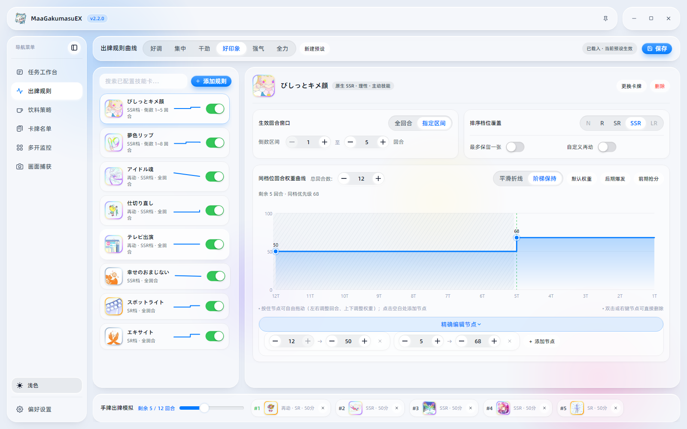
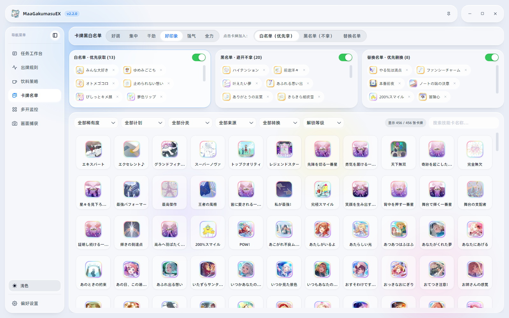
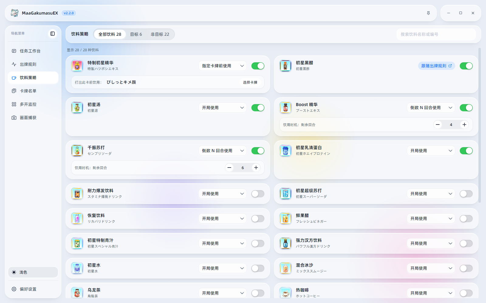
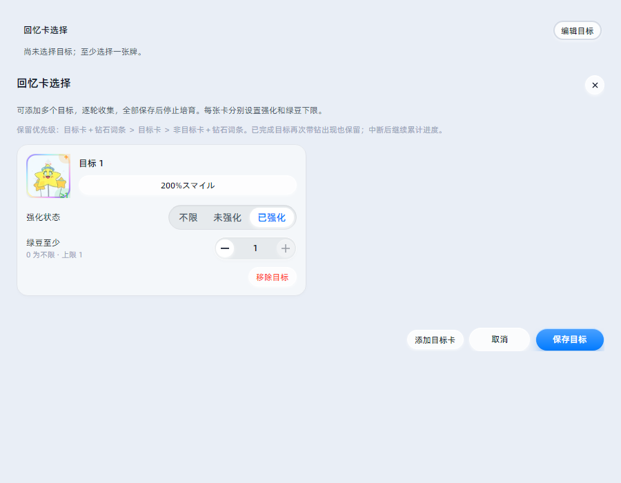

<!-- markdownlint-disable MD033 MD041 -->

# MaaGakumasu EX

 

    
    
    

    
    

 

一款《学園アイドルマスター》游戏小助手

帮你跑日常、养偶像，出牌规则和饮料时机也能自己定！

在原版基础上加入策略设置、HIF 培育与回忆收集。[原版 MaaGakumasu](https://github.com/SuperWaterGod/MaaGakumasu)

[下载正式版](https://github.com/Quiter53/MaaGakumasuEX/releases/latest) | [使用指南](docs/zh_cn/EX使用指南.md) | [更新记录](https://github.com/Quiter53/MaaGakumasuEX/releases) | [问题反馈](https://github.com/Quiter53/MaaGakumasuEX/issues)

## 下载与安装

下载 Windows x64 便携包 `MaaGakumasuEX-版本号-win-x64-portable.zip`，解压后运行 `MaaGakumasu.exe`。运行包自带 Python 环境。[下载正式版](https://github.com/Quiter53/MaaGakumasuEX/releases/latest)

推荐使用 MuMu 12，游戏画面设为 `720 × 1280`、`240 DPI`，也支持连接 DMM 游戏窗口。初次使用先检查任务与策略设置，再开始运行。[使用指南](docs/zh_cn/EX使用指南.md)

## 亮点功能

保留原版的日常任务、初与 NIA 自动培育，EX 另外加入了这些功能。

- **新工作台**，任务、参数、日志和实时画面自由排布，拖动调整大小，深浅主题随时切换。
- **出牌规则**，使用条件、优先级曲线和连携都能自己定。六种职业预设支持分享，配好后用手牌模拟看看效果！
- **卡牌名单**，想要的牌、想避开的牌、想换掉的牌，直接从卡库拖进对应名单。
- **饮料策略**，开局喝、指定卡牌出牌前喝，或留到最后几回合，各种饮料分别安排。
- **HIF 培育（测试中）**，支持选拔与本战，加入课程属性、第三周行动、幕间回血和试镜手动接管等设置。
- **自动自定义**，为已持有、已强化的卡设置目标次数，在特别指导和 HIF 轮间商店按顺序补足。
- **回忆收集**，指定目标卡、强化状态和绿豆下限，逐轮收集、保存进度。刷卡组时按整组条件筛选，同一份回忆满足目标才算完成。

来看看界面！

### 任务工作台

<picture>
  <source media="(prefers-color-scheme: dark)" srcset="./docs/img/ex/workbench-dark.png">
  
</picture>

### 出牌规则与手牌模拟

<picture>
  <source media="(prefers-color-scheme: dark)" srcset="./docs/img/ex/card-rules-dark.png">
  
</picture>

### 卡牌名单

<picture>
  <source media="(prefers-color-scheme: dark)" srcset="./docs/img/ex/card-lists-dark.png">
  
</picture>

### 饮料策略

<picture>
  <source media="(prefers-color-scheme: dark)" srcset="./docs/img/ex/drinks-dark.png">
  
</picture>

### 回忆目标编辑

<picture>
  <source media="(prefers-color-scheme: dark)" srcset="./docs/img/ex/memory-target-dark.png">
  
</picture>

## 使用说明

出牌规则、卡牌名单、饮料策略、回忆收集和配置备份的详细操作，请参阅 [使用指南](docs/zh_cn/EX使用指南.md)。

遇到卡住、识别出错或其他问题，欢迎附上 EX 版本、运行环境及相关日志和截图来反馈。分享前记得隐去账号和连接信息。[提交问题](https://github.com/Quiter53/MaaGakumasuEX/issues) · [反馈指南](docs/zh_cn/提问与反馈指南.md)

## 参与开发

欢迎提交问题、补充识别样本，或者直接发 PR！构建方法和代码位置可从这些文档开始看。[本地构建](docs/zh_cn/EX使用指南.md#本地构建) · [源码组织](docs/development/source-layout.md) · [开发指南](docs/zh_cn/开发相关.md) · [Lab 测试工具](https://github.com/Quiter53/MaaGakumasuEX-Lab)

## 致谢

- 游戏自动化基础，感谢原版作者与贡献者。[MaaGakumasu](https://github.com/SuperWaterGod/MaaGakumasu) · [上游贡献者](https://github.com/SuperWaterGod/MaaGakumasu/graphs/contributors)
- 图像识别与设备控制框架。[MaaFramework](https://github.com/MaaXYZ/MaaFramework)
- 原生客户端基础。[MFAAvalonia](https://github.com/SweetSmellFox/MFAAvalonia)
- 状态条件、连携与职业分享的设计参考，以及三种状态指针模板。[miyu1019/MaaGakumasu](https://github.com/miyu1019/MaaGakumasu)

感谢参与开发和测试的朋友们！

## 声明

本仓库保留上游的 [AGPL-3.0 许可证](LICENSE)。原生客户端与其他依赖的许可证随对应源码保留。

本项目仅用于学习交流，请勿用于商业用途。本项目仅提供自动化脚本，不提供任何游戏资源。

本软件开源、免费，仅供学习交流使用。若您遇到商家使用本软件进行代练并收费，可能是分发、设备或时间等费用，产生的费用、问题及后果与本软件无关。

**在使用过程中，MaaGakumasu 可能存在任何意想不到的问题，因 MaaGakumasu 自身漏洞、文本理解有歧义、异常操作导致的账号问题等开发组不承担任何责任，请在确保在阅读完用户手册、自行尝试运行效果后谨慎使用！**
